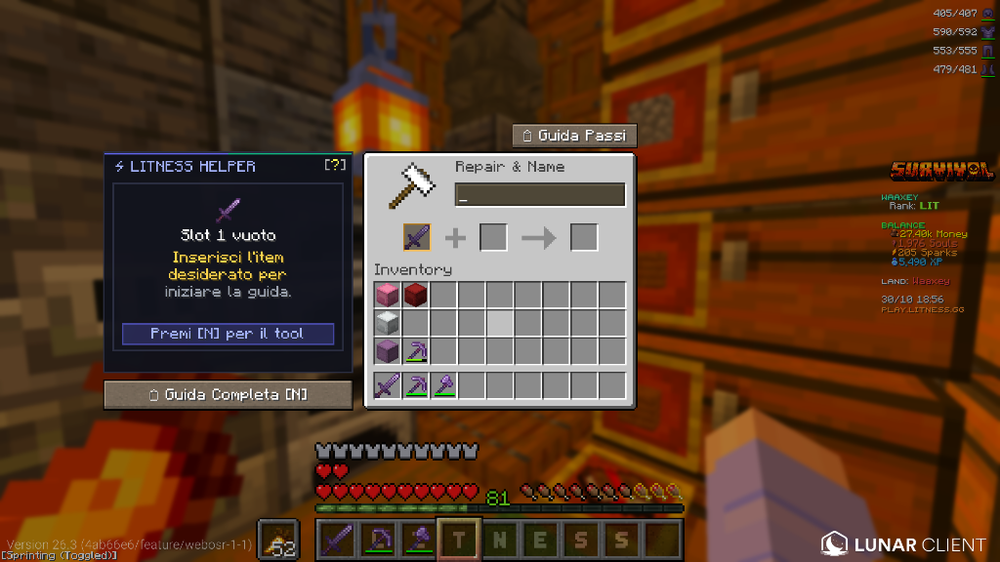
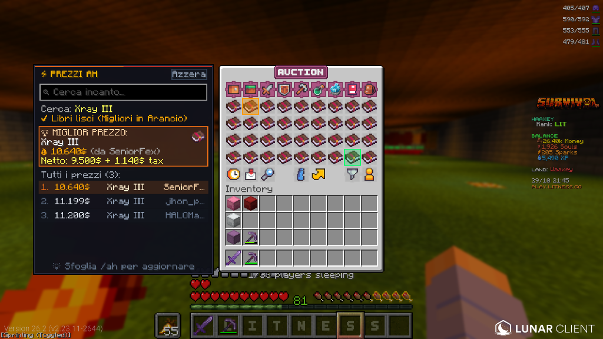

# ⚡ Litness Enchant Helper

[-VERSIONE%201.2.5-22c55e?style=for-the-badge&logo=curseforge&logoColor=white)](https://github.com/Infezione/litness-enchant-helper/releases/download/v1.2.5/LitnessEnchantHelper-1.2.5.jar)
[](#ultimi-aggiornamenti)


> [!TIP]
> ### 💡 Come aprire il menu in gioco:
> Premi semplicemente il tasto **`N`** sulla tastiera in qualsiasi momento per aprire la schermata principale (Catalogo Incantesimi, Calcolatore, Guida Fusione e I Miei Set).  
> *(Puoi anche personalizzare il tasto in `Opzioni -> Comandi -> Controlli` di Minecraft sotto la voce "Litness Optimizer").*  
> 👉 *Per consultare tutte le nuove funzioni appena introdotte, clicca sul pulsante in alto o vai a [🌟 Ultimi Aggiornamenti](#ultimi-aggiornamenti).*

**Litness Enchant Helper** è la mod Fabric client-side definitiva progettata per i giocatori del server Minecraft **Litness**.  
Il suo obiettivo principale è eliminare ogni spreco di livelli di esperienza, evitare il famigerato errore di Minecraft vanilla *"Troppo Costoso! (>39 livelli)"* e guidare il giocatore passo dopo passo nella creazione dell'equipaggiamento perfetto, supportando sia tutti gli incantesimi Vanilla sia tutti gli incantesimi Custom esclusivi del server.

---

## 🌟 Perché è indispensabile su Litness?

Sul server Litness, forgiare spade, archi, picconi o armature con 10–12 incantesimi (tra Vanilla e Custom) può diventare proibitivo a causa della meccanica di penalità cumulativa dell'incudine di Minecraft (*Prior Work Penalty*). Se i libri vengono fusi nell'ordine sbagliato, l'incudine raggiungerà rapidamente il limite di 39 livelli, rendendo l'oggetto impossibile da completare.

**Litness Enchant Helper** risolve questo problema alla radice calcolando matematicamente la sequenza ideale ad albero binario (*Pareto-Optimal*), garantendo il costo totale di XP più basso possibile e rimanendo sempre ampiamente sotto la soglia massima consentita.

---

## 🚀 Funzionalità Dettagliate

### 1. ⚡ Assistente Incudine in Tempo Reale

- **Sidebar integrata in Dark Glass**: non appena apri un'incudine di gioco, compare lateralmente un'elegante interfaccia trasparente a tema scuro perfettamente allineata alla GUI nativa di Minecraft.
- **Ologramma Pulsante (Ghost Slot)**: quando lo slot 1 dell'incudine è vuoto, viene renderizzata una sagoma olografica semitrasparente e dorata che pulsa morbidamente, con il tooltip: *"Inserisci l'item desiderato per iniziare la guida."*. L'ologramma svanisce istantaneamente non appena posizioni l'arma o l'armatura!
- **Analisi Intelligente Maxabilità & Limite 39 Livelli ("Troppo Costoso!")**:
  - Rileva in automatico la penalità pregressa da lavorazione (*Prior Work Penalty*) di oggetti già usati o parzialmente incantati.
  - Se l'oggetto ha margine per essere completato con tutti i 12 incantesimi, mostra il badge `✔ Maxabile (12/12)`.
  - Se il tetto dei 39 livelli impedirebbe il completamento totale, la mod calcola matematicamente a ritroso e avvisa subito:  
    `⚠️ Troppo Costoso se provi a maxarlo tutto! Puoi aggiungere ancora fino a N incantesimi (Max +N)`.
  - Passando il mouse sopra l'item o sul riquadro informativo, appare un tooltip dettagliato con penalità attuale, storico delle lavorazioni e stima dei passaggi residui.
- **Riconoscimento Automatico di Armi e Strumenti**: riconosce all'istante la tipologia dell'oggetto (Spade, Archi, Balestre, Mazze, Tridenti, Picconi, Asce e Armature), aggiornando istruzioni e badge su misura (es. `🏹 TEMPRA ARCO`, `🗡 TEMPRA SU OGGETTO`).
- **Istruzioni Chiare di Fusione**:
  - `📖 UNISCI LIBRI`: ti mostra esattamente quali due libri del tuo inventario combinare per primi per mantenere bassa la penalità.
  - `🗡 TEMPRA SU OGGETTO`: ti segnala il momento perfetto in cui fondere il libro combinato direttamente sul tuo equipaggiamento.

---

### 2. 📖 Guida alla Fusione Passo-Passo (Albero Ottimale)

- **Albero Binario Pareto-Ottimale**: calcola la sequenza matematica perfetta che minimizza sia la penalità da incudine che la spesa totale di livelli XP.
- **Icone Grafiche Minecraft Native**: ogni step illustra visivamente gli slot dell'incudine (Slot 1, Slot 2 e Risultato) con gli sprite grafici ufficiali di Minecraft per armi, attrezzi e libri.
- **Tracking Inventario in Tempo Reale**: su ogni passaggio della guida, un badge verde `✔ In Inventario` ti segnala se possiedi già quel libro nel tuo inventario personale.
- **Selettore di Penalità Iniziale (`[Pen: +X]`)**: pulsanti rapidi in cima alla schermata per simulare o calcolare la guida partendo da oggetti che hanno già penalità pregressa (+0, +1, +3, +7, +15, +31).
- **Copia Rapida Negli Appunti (`[📋 Copia Passi]`)**: copia con un solo clic l'intera sequenza ordinata con costi ed XP, pronta per essere condivisa su Discord o appuntata.

---

### 3. ✨ Creatore & Gestore "Set Futuri"
- **Pianificazione Libera fino a 12 Incantesimi**: crea in anticipo la combinazione dei sogni per qualsiasi pezzo di equipaggiamento (Spade, Picconi, Archi, Balestre, Mazze, Elmi, Corazze, Gambali, Stivali).
- **Supporto Vanilla, Vanilla+ (Efficienza VI) e Custom**: seleziona liberamente tra tutti gli incantesimi standard e quelli speciali ed esclusivi di Litness.
- **Filtri Specifici per Categoria Strumento**: selezionando la tipologia di oggetto, la lista mostra esclusivamente gli incantesimi applicabili a quel pezzo.
- **Anti-Conflitto Bidirezionale**: evidenzia istantaneamente incompatibilità dirette (es. *Affilatezza* vs *Anatema*, *Efficienza VI* vs *Efficienza I-V*).
- **Salvataggio Persistente**: assegna un nome al set (es. *Spada Boss Dungeon*, *Armatura PvP*, *Piccone Farm*) e salvalo in locale.
- **Guida Teorica Istantanea**: genera con un clic tutti i passaggi di fusione ottimali anche se non possiedi ancora tutti i libri nell'inventario.

---

### 4. 📌 Pin HUD Checklist in Gioco (Real-Time Tracking)

- **Checklist Sempre Attiva a Schermo**: segui l'avanzamento del tuo set direttamente in partita senza dover riaprire i menù.
- **Tre Stati Visivi Intelligenti**:
  - 🟢 `✔ In Inventario`: se il libro incantato è presente nel tuo inventario.
  - 🟣 `✔ Applicato`: se l'incantesimo è già presente sull'oggetto impugnato o indossato nello slot corretto.
  - ⚪ `  Mancante`: incantesimo ancora da acquistare o trovare.
- **Pinnabile con un Clic**: attiva o rimuovi il pin HUD in qualsiasi momento tramite il pulsante `[📌 Pin HUD]` / `[✔ Pinnato]` nella scheda del set.

---

### 5. 🛡️ Sistema Anti-Errore e Rilevamento Conflitti

- **Matrice Completa di Compatibilità**: controlla le incompatibilità del gioco originale (es. *Protezione* vs *Protezione dal fuoco / Proiettili / Esplosioni*) e quelle custom del server Litness (es. *Spine* vs *Static Barrier*).
- **Indicatore Visivo di Pericolo `⚠️`**: quando provi a selezionare o combinare due incantesimi incompatibili, appare un avviso chiaro che specifica contro quale incantesimo si verifica il conflitto.
- **Prevenzione Sprechi**: protegge i tuoi libri rari da combinazioni errate che verrebbero rifiutate dall'incudine o dal server.

---

### 6. 📚 Catalogo Completo degli Incantesimi (Vanilla & Custom)

- **Database Aggiornato al 100%**: comprende tutti gli incantesimi Vanilla, Vanilla+ (*Efficienza VI*) e tutti i Custom esclusivi di Litness.
- **Ricerca Intelligente Bilingue**: cerca rapidamente digitando il nome in italiano o l'identificatore/alias in inglese.
- **Filtri Rapidi con Icone per Strumento**: passa istantaneamente da una categoria all'altra con un clic (*🗡 Spada, ⛏ Piccone, 🛡 Armature, 🏹 Arco, 🪓 Ascia, 🌾 Zappa, 📦 Altri*).
- **Schede Dettagliate**: visualizza il grado di rarità ufficiale, la spiegazione accurata degli effetti in-game, il cap di livello massimo e il costo base dell'incudine.
- **Pulsante di Ricerca Asta Diretto (`[+ Cerca AH]`)**: invia l'incantesimo direttamente alla barra di ricerca rapida dell'Asta e dei contenitori.

---

### 7. 🔍 Tooltip Arricchiti nell'Inventario (Lore & Info Live)

- **Auto-Learning Dinamico dal Server**: legge direttamente dal lore del server la riga `Costo incantesimi: +X livelli` sincronizzando i calcoli al 100% con il server di gioco, senza mai duplicare le righe del tooltip.
- **Grado di Rarità Ufficiale**: badge colorato con la classificazione ufficiale di Litness (*[COMUNE]*, *[NON COMUNE]*, *[RARO]*, *[EPICO]*, *[LEGGENDARIO]*, *[SPECIALE]*, *[MOLTO SPECIALE]*).
- **Indicatore Livello Massimo & Icone Compatibilità**: evidenzia se l'incantesimo ha raggiunto il livello massimo (`[V Max II]`) e mostra le icone grafiche di tutti i pezzi compatibili.
- **Rilevamento Conflitti Istantaneo**: ti avverte direttamente nel tooltip se il libro che stai osservando è incompatibile con gli incantesimi già presenti sui tuoi oggetti.
- **Funziona Ovunque**: attivo su libri lisci, libri combinati, armi e armature sia nell'inventario che dentro bauli e shulker box.

---

### 8. 🟢 Assistente Prezzi /ah & Ricerca in Casse, Shulker ed Ender Chest!

- **Sidebar Laterale Intelligente `/ah` con Ricerca Live**: aprendo la Casa d'Aste (`/ah`), compare a sinistra una sidebar interattiva (*⚡ PREZZI AH*) con campo di ricerca in tempo reale per digitare il nome dell'incantesimo senza dover sfogliare decine di pagine a vuoto.
- **Completamento Automatico con Icone Native Minecraft**: mentre scrivi, la tendina suggerisce istantaneamente gli incantesimi compatibili con l'icona grafica nativa dello strumento associato e i tag di categoria:
  - `[V]` = Incantesimi **Vanilla** (es. *Atterraggio morbido*, *Maledizione del legame*, *Impalamento*).
  - `[V+]` = Incantesimi **Vanilla+** (es. *Efficienza VI*).
  - `[C]` = Incantesimi **Custom** esclusivi di Litness (es. *Xray*, *Berserker*, *Telecinesi*).
- **Confronto Prezzi Intelligente & Calcolo Tasse Server (`MIGLIOR PREZZO`)**:
  - Scansiona tutti i libri in vendita nell'asta e individua automaticamente l'offerta più economica.
  - Calcola in automatico il prezzo netto e le tasse di compravendita del server (es. `Netto: 9.500$ + 1.140$ tax`).
  - Mostra la classifica ordinata dei venditori più convenienti (`1. 10.640$ da SeniorFex`, `2. 11.199$ da jhon_p...`).
- **Doppia Evidenziazione Visiva in Asta**:
  - 🟠 **Arancione Oro Brillante**: mette in risalto lo slot del libro con il **Miglior Prezzo** assoluto.
  - 🟢 **Verde Smeraldo**: evidenzia tutti gli altri libri lisci corrispondenti alla ricerca per distinguerli a colpo d'occhio dai libri con incantesimi spazzatura misti.
- **Rilevamento Profondo in Bauli, Casse, Barili e Shulker**:
  - Puoi attivare la ricerca anche dal **Catalogo Incantesimi** (tasto `N`) con il pulsante `[+ Cerca AH]`.
  - Aprendo qualsiasi Baule, Cassa doppia, Barile o Ender Chest, tutti i libri cercati si illuminano di verde.
  - Se il libro si trova **all'interno di una Shulker Box**, l'intera scatola di Shulker si illumina in verde, indicandoti subito dove si trova senza dover aprire decine di shulker a caso.
  - Pulsante rapido `[Azzera]` in alto a destra della sidebar per resettare qualsiasi ricerca attiva con un solo clic.

---

<a id="ultimi-aggiornamenti" name="ultimi-aggiornamenti"></a>
<a id="-ultimi-aggiornamenti" name="-ultimi-aggiornamenti"></a>

## 🌟 Ultimi Aggiornamenti (v1.2.5)

- 🚀 **Compatibilità Ufficiale Minecraft 26.3 & Lunar Client 26.3**:
  - Aggiornato l'intero codice sorgente per supportare nativamente **Minecraft 26.3** e Fabric API 0.160.7.
  - Migrazione al nuovo motore di input standard (`InputConstants.Type.KEYBOARD`), aggiornate le API delle Bundle (`itemCopies()`) e del browser di sistema.
  - Pienamente compatibile con il profilo **Lunar Client 26.3** (`fabric-26.3`).
- 🛡️ **Analisi Intelligente Maxabilità & Calcolo Limite 39 Livelli ("Troppo Costoso!")**:
  - Se inserisci nell'incudine un'arma o armatura che è già stata incantata in precedenza (accumulando la *Prior Work Penalty*), la mod analizza istantaneamente la fattibilità matematica di tutti i rami di fusione possibili.
  - **Avviso Preventivo Troppo Costoso**: se l'oggetto non può raggiungere tutti gli incantesimi massimi (es. 12/12) a causa del tetto vanilla dei 39 livelli, la mod lo segnala subito:
    `⚠️ Troppo Costoso se provi a maxarlo tutto! Puoi aggiungere ancora fino a N incantesimi (Max +N)`.
  - **Badge e Tooltip Trasparente**: un badge dinamico nella sidebar e un tooltip dedicato mostrano il livello di penalità esatto, il numero di lavorazioni pregresse e gli incantesimi residui applicabili.
- 👻 **Ologramma Pulsante (Ghost Slot) nello Slot 1 dell'Incudine**:
  - Quando lo slot 1 reale dell'incudine è vuoto, viene renderizzata una sagoma olografica semitrasparente e pulsante (con animazione dorata fluida) dell'arma o armatura consigliata.
  - Tooltip esplicativo: *"Inserisci l'item desiderato per iniziare la guida."*. Non appena posizioni l'oggetto, l'ologramma svanisce all'istante!
- ⛏️ **Supporto Completo ad Efficienza VI (Vanilla+)**:
  - Introdotto l'incantesimo Vanilla+ *Efficienza VI* (costo base 6 livelli XP).
  - Integrato nel Catalogo incantesimi, nella Creazione e Modifica dei Set Futuri e nel calcolatore matematico dell'incudine con gestione bidirezionale dei conflitti con Efficienza I-V.
- 🎯 **Fix Riconoscimento Armi/Archi (Bow vs Sword)**:
  - Risolto il problema per cui inserendo un arco nell'incudine veniva indicato il tema "Spada". Ora rileva in modo affidabile Archi, Balestre, Spade, Mazze, Tridenti e attrezzi, aggiornando badge (`🏹 TEMPRA ARCO`), categorie e guida in automatico.
- 📊 **Sidebar Prezzi Live, Ricerca Rapida e Icone Grafiche in `/ah`**:
  - Interfaccia laterale integrata con barra di ricerca, icone native Minecraft, calcolo delle tasse, evidenziazione del miglior prezzo in arancione, lista venditori e tag `[V]`, `[V+]`, `[C]`.
- 📖 **Documentazione e Guide Sotto gli Screenshot Completamente Rinnovate**:
  - Riscritte tutte le sezioni descrittive del README per riflettere le funzionalità e il design moderno della mod.

---

## 🎮 Controlli & Tasti Rapidi

| Tasto / Controllo | Azione |
| :--- | :--- |
| **`N`** | Apri la schermata principale (Catalogo / Guida Fusione / I Miei Set) |
| **`[📖 Guida Passi]`** | Tasto rapido in cima all'interfaccia dell'incudine per aprire la guida |
| **`[📋 Copia Passi]`** | Copia l'intera sequenza di fusione negli appunti |
| **`[Pen: +X]`** | Seleziona manualmente la penalità di lavoro precedente dell'oggetto (+0, +1, +3, +7, +15, +31) |
| **`[ESC]`** | Chiudi la schermata e torna al gioco |

---

## 📦 Installazione

### Metodo 1: Per Lunar Client (Consigliato)
1. Scarica il file **`LitnessEnchantHelper-1.2.5.jar`** dall'area [Releases](../../releases).
2. Premi sulla tastiera `Win + R`, incolla la seguente stringa e premi **Invio**:
   ```text
   %userprofile%\.lunarclient\profiles\26\mods\fabric-26.3\
   ```
3. Incolla il file `.jar` scaricato all'interno di questa cartella.
4. Avvia Minecraft selezionando la versione **Lunar Client 26.3 (Fabric)**.

### Metodo 2: Per Fabric Launcher Standard
1. Assicurati di avere installato **Fabric Loader** per Minecraft 26.3 e la **Fabric API**.
2. Posiziona il file `LitnessEnchantHelper-1.2.5.jar` nella cartella `.minecraft/mods/`.
3. Avvia il gioco.

---

## 👤 Autore & Crediti

- **Sviluppato da**: **Waaxey**
- Realizzato appositamente per la community del server **Litness**.
- Licenza: [MIT License](LICENSE)
