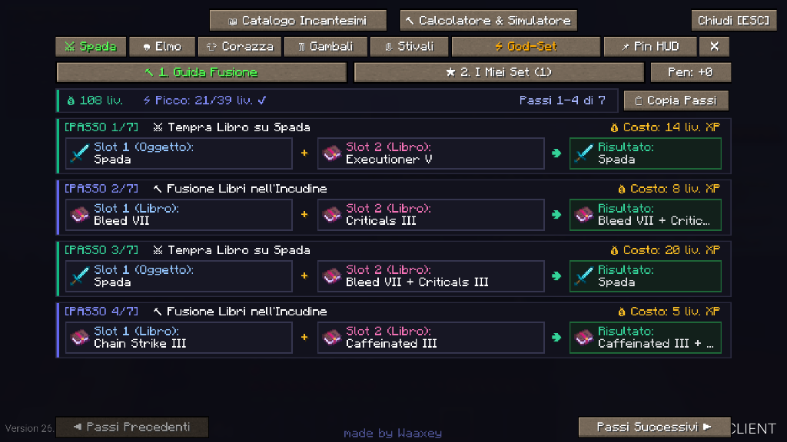
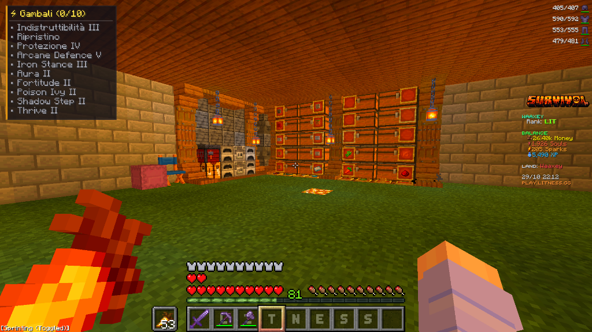
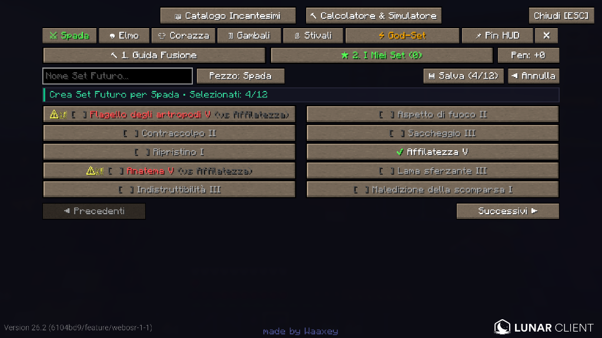
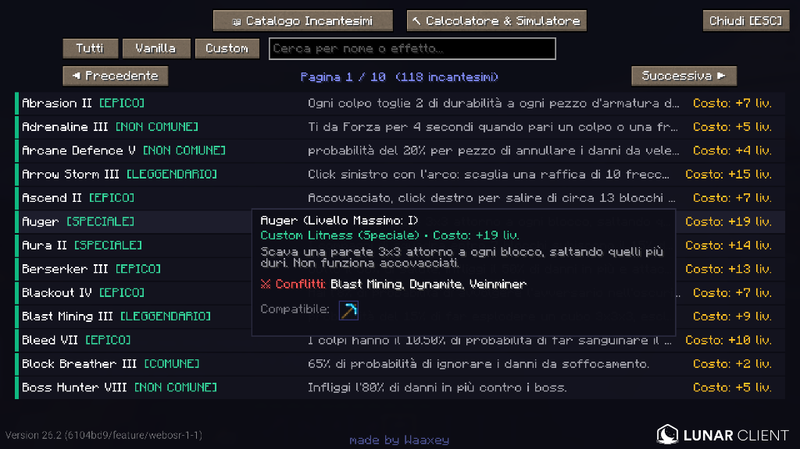
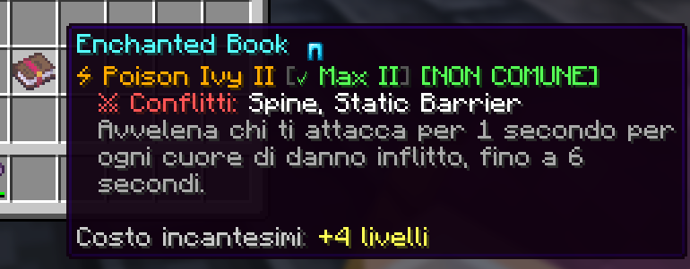
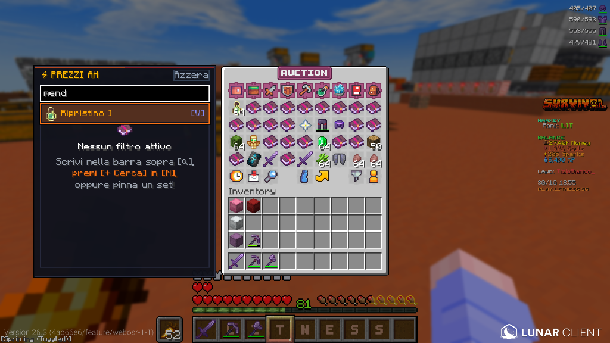

# ⚡ Litness Enchant Helper

[-VERSIONE%201.2.1-22c55e?style=for-the-badge&logo=curseforge&logoColor=white)](https://github.com/Infezione/litness-enchant-helper/releases/download/v1.2.1/LitnessEnchantHelper-1.2.1.jar)
[](#-ultimi-aggiornamenti)


> [!TIP]
> ### ⌨️ Come aprire il menu in gioco:
> Premi semplicemente il tasto **`N`** sulla tastiera in qualsiasi momento per aprire la schermata principale (Catalogo Incantesimi, Calcolatore, Guida Fusione e I Miei Set).  
> *(Puoi anche personalizzare il tasto in `Opzioni -> Comandi -> Controlli` di Minecraft sotto la voce "Litness Optimizer").*  
> 👉 *Per consultare tutte le nuove funzioni appena introdotte, clicca sul pulsante in alto o vai a [🔄 Ultimi Aggiornamenti](#-ultimi-aggiornamenti).*

**Litness Enchant Helper** è la mod Fabric client-side definitiva progettata per i giocatori del server Minecraft **Litness**.  
Il suo obiettivo principale è eliminare ogni spreco di livelli di esperienza, evitare il famigerato errore di Minecraft vanilla *"Troppo Costoso! (>39 livelli)"* e guidare il giocatore passo dopo passo nella creazione dell'equipaggiamento perfetto, supportando sia tutti gli incantesimi Vanilla sia tutti gli incantesimi Custom esclusivi del server.

---

## 🌟 Perché è indispensabile su Litness?

Sul server Litness, forgiare spade, archi, picconi o armature con 10–12 incantesimi (tra Vanilla e Custom) può diventare proibitivo a causa della meccanica di penalità cumulativa dell'incudine di Minecraft (*Prior Work Penalty*). Se i libri vengono fusi nell'ordine sbagliato, l'incudine raggiungerà rapidamente il limite di 39 livelli, rendendo l'oggetto impossibile da completare.

**Litness Enchant Helper** risolve questo problema alla radice calcolando matematicamente la sequenza ideale ad albero binario (*Pareto-Optimal*), garantendo il costo totale di XP più basso possibile e rimanendo sempre ampiamente sotto la soglia massima consentita.

---

## 🎯 Funzionalità Dettagliate

### 1. ⚡ Assistente Incudine in Tempo Reale

- **Sidebar integrata**: non appena apri un'incudine di gioco, compare lateralmente una schermata pulita in stile *dark glass* che si adatta perfettamente alla GUI di Minecraft.
- **Rilevamento istantaneo**: riconosce automaticamente l'oggetto inserito nel primo slot (o tenuto in mano), la sua penalità attuale e i libri presenti nel tuo inventario.
- **Istruzioni chiare**:
  - `🔨 UNISCI LIBRI`: ti indica quali due libri incantati del tuo inventario unire per primi per ottimizzare la penalità.
  - `⚔ TEMPRA SU OGGETTO`: ti segnala quando è il momento perfetto per applicare il libro risultante sulla tua arma o armatura.

---

### 2. 🔨 Guida alla Fusione Passo-Passo (Albero Ottimale)

- **Calcolo istantaneo**: visualizza ogni singolo passaggio con gli slot dell'incudine (Slot 1, Slot 2 e Risultato), con icone grafiche per ciascun pezzo.
- **Indicatore inventario**: su ogni passaggio della guida, un badge verde `✔ In Inventario` ti segnala se possiedi già quel libro nel tuo inventario.
- **Costi trasparenti**: mostra il costo in livelli di ciascun singolo step e il picco massimo di livelli richiesti.
- **Copia rapida**: con il pulsante `[📋 Copia Passi]` puoi copiare l'intera guida formattata negli appunti per incollarla in chat, su Discord o sul blocco note.

---

### 3. ⭐ Creatore & Gestore "Set Futuri"
- **Pianificazione libera**: crea in anticipo la combinazione dei sogni per qualsiasi pezzo di equipaggiamento (Spada, Piccone, Elmo, Corazza, Gambali o Stivali).
- **Lista da zero**: quando crei un nuovo set, la lista parte completamente pulita per permetterti di selezionare fino a 12 incantesimi desiderati.
- **Salvataggio persistente**: assegna un nome al set (es. *Spada Dungeon Boss*, *Corazza PvP*, *Piccone Farm*) e salvalo in memoria locale.
- **Guida teorica immediata**: cliccando `⚡ Guida` su qualsiasi set salvato, la mod genera immediatamente tutti i passaggi di fusione teorici anche se non possiedi ancora tutti i libri nel tuo inventario.

---

### 4. 📌 Pin HUD Checklist in Gioco (Real-Time Tracking)

- **Checklist sempre attiva a schermo**: tieni d'occhio i tuoi progressi direttamente durante il gameplay senza dover riaprire il menu ogni volta.
- **Tracking visivo intelligente**:
  - 🟢 `✔ In Inventario`: se possiedi già il libro incantato nell'inventario.
  - 🔴 `✔ Applicato`: se l'incantesimo è già stato applicato sull'oggetto (con verifica specifica sullo slot di competenza: mano principale per armi/attrezzi, slot armatura per pezzi d'armatura).
  - ⚪ `• Mancante`: incantesimo ancora da reperire.
- **Pinnabile con un clic**: attiva o disattiva il Pin direttamente dalla scheda del set in *"I Miei Set"* tramite il pulsante `[📌 Pin HUD]` / `[★ Pinnato]`.

---

### 5. ⚠️ Sistema Anti-Errore e Rilevamento Conflitti

- **Triangolo di pericolo `⚠️`**: quando selezioni un incantesimo incompatibile con altri già scelti (es. *Affilatezza* vs *Anatema*, *Protezione* vs *Protezione dal fuoco*, ecc.), la mod mostra un triangolo di allerta e indica con precisione contro quale incantesimo va in conflitto.
- **Prevenzione sprechi**: impedisce di sprecare libri rari e preziosi in combinazioni non permesse dal gioco o dal regolamento del server.

---

### 6. 📖 Catalogo Completo degli Incantesimi (Vanilla & Custom)

- **Tutti gli incantesimi di Litness**: include l'intero archivio degli incantesimi Custom del server e quelli Vanilla di Minecraft.
- **Filtri rapidi avanzati**: ricerca testuale istantanea (con supporto per nomi italiani e alias inglesi), filtri di categoria (*Tutti / Vanilla / Custom*) e **filtri rapidi per tipo di oggetto** (*⚔ Spada, ⛏ Piccone, 🛡 Armature, 🏹 Arco, 🪓 Ascia, 🌾 Zappa, 🔧 Altri*).
- **Schede informative**: visualizza rarità (*Comune, Non comune, Raro, Epico, Leggendario, Speciale, Molto speciale*), descrizione completa, livello massimo, pezzi compatibili e costo base dell'incudine.

---

### 7. 🔮 Tooltip Arricchiti nell'Inventario (Lore & Info Live)

- **Info immediate sui libri**: passando il cursore su qualsiasi libro incantato nel tuo inventario o nelle casse, la mod arricchisce automaticamente la lore di gioco con:
  - 🏷️ **Grado di Rarità**: visualizza il badge colorato della rarità ufficiale (*[COMUNE]*, *[NON COMUNE]*, *[RARO]*, *[EPICO]*, *[LEGGENDARIO]*, *[SPECIALE]*, *[MOLTO SPECIALE]*).
  - ⚡ **Livello Massimo**: indica se l'incantesimo ha raggiunto il cap (`[✓ Max II]`) o il livello massimo disponibile.
  - 🛡️ **Icone strumenti compatibili**: visualizza subito l'icona grafica dell'oggetto su cui è applicabile (es. armature, spade, asce, picconi).
  - ⚠️ **Rilevamento Conflitti**: segnala istantaneamente le incompatibilità dirette (es. `※ Conflitti: Spine, Static Barrier`).
  - 💰 **Costo Base Incudine**: calcola in anticipo il costo netto in livelli di XP per applicare quel libro.

---

### 8. 🟢 Trova Subito gli Incantesimi in AH, Casse, Barili, Shulker ed Ender Chest!

- **Trova subito qualsiasi incantesimo in Asta e nei Bauli**: dal **Catalogo Incantesimi** (tasto `N`), basta cliccare sul pulsante **`[+ Cerca AH]`** accanto a qualsiasi incantesimo desiderato per attivare la ricerca e l'evidenziazione immediata.
- **Spotting visivo istantaneo**: aprendo la Casa d'Aste (`/ah`), il menu catalogo (`/enchgui`), oppure qualsiasi **Cassa (singola o doppia)**, **Barile**, **Shulker Box** o **Ender Chest**, tutti i libri lisci corrispondenti vengono evidenziati all'istante con uno sfondo traslucido e un contorno verde smeraldo brillante.
- **Rilevamento Profondo nelle Scatole di Shulker**: se in una cassa o nell'ender chest è presente una **Shulker Box** che contiene al suo interno il libro cercato, la Shulker Box stessa si illumina in verde, indicando all'istante dove si trova il libro senza dover aprire decine di shulker a caso!
- **Supporto multi-selezione & Reset rapido**: puoi selezionare uno o più incantesimi contemporaneamente; nella parte superiore del Catalogo è sempre presente il pulsante rapido `[✕ Azzera AH]` per pulire le ricerche attive con un solo clic.
- **Zero interferenze**: l'evidenziazione visiva viene applicata unicamente sugli slot del contenitore o del mercato, lasciando intatto e ordinato il tuo inventario personale.

---

<a id="ultimi-aggiornamenti"></a>
## 🔄 Ultimi Aggiornamenti (v1.2.1)

- ⚡ **Riconoscimento Infallibile & Apertura Automatica di `/ah`**: Risolto il problema che impediva l'apertura del Monitor Prezzi laterale nella Casa d'Aste di Litness a causa del titolo texture custom. Ora la mod riconosce istantaneamente `/ah` sia dal titolo che dalla presenza delle informazioni di vendita negli slot.
- 🏆 **Box 'Miglior Prezzo' & Classifica Prezzi in Tempo Reale**: A sinistra della schermata `/ah` appare il pannello laterale con il miglior prezzo in evidenza (con venditore, prezzo totale, prezzo netto e calcolo tasse es. *500$ + 60$ tax*) e la classifica ordinata dal più economico al più costoso man mano che si sfogliano le pagine dell'asta.
- 🧹 **Filtraggio Libri Lisci al 100%**: Mostra ed evidenzia rigorosamente solo i libri contenenti unicamente l'incantesimo cercato, scartando libri ibridi o con incantesimi spazzatura.
- 🔗 **Integrazione Automatica con i Set Pinnati**: La ricerca in `/ah` monitora sia gli incantesimi selezionati con `[+ Cerca AH]` nel Catalogo, sia gli incantesimi mancanti del set attualmente pinnato a schermo se non ci sono filtri manuali attivi.
- 🔍 **Barra di Ricerca Istantanea nella Creazione Set**: Campo di ricerca in tempo reale nel set builder per trovare all'istante qualsiasi incantesimo senza scorrere pagine.
- 🖼️ **Icone Tematiche Visive**: Icona grafica tematica di Minecraft per ciascun incantesimo nel Catalogo e nel Costruttore Set.
- 🔢 **Fix Risolutivo Numeri Romani**: Rimossa ogni duplicazione dei numeri romani nei libri e nei passaggi della guida.

---

## 🎮 Controlli & Tasti Rapidi

| Tasto / Controllo | Azione |
| :--- | :--- |
| **`N`** | Apri la schermata principale (Catalogo / Guida Fusione / I Miei Set) |
| **`[📋 Guida Passi]`** | Tasto rapido in cima all'interfaccia dell'incudine per aprire la guida |
| **`[📋 Copia Passi]`** | Copia l'intera sequenza di fusione negli appunti |
| **`[Pen: +X]`** | Seleziona manualmente la penalità di lavoro precedente dell'oggetto (+0, +1, +3, +7, +15, +31) |
| **`[ESC]`** | Chiudi la schermata e torna al gioco |

---

## 📥 Installazione

### Metodo 1: Per Lunar Client (Consigliato)
1. Scarica il file **`LitnessEnchantHelper-1.2.1.jar`** dall'area [Releases](../../releases).
2. Premi sulla tastiera `Win + R`, incolla la seguente stringa e premi **Invio**:
   ```text
   %userprofile%\.lunarclient\profiles\26\mods\fabric-26.2\
   ```
3. Incolla il file `.jar` scaricato all'interno di questa cartella.
4. Avvia Minecraft selezionando la versione **Lunar Client 26.2 (Fabric)**.

### Metodo 2: Per Fabric Launcher Standard
1. Assicurati di avere installato **Fabric Loader** per Minecraft 26.2 e la **Fabric API**.
2. Posiziona il file `LitnessEnchantHelper-1.2.1.jar` nella cartella `.minecraft/mods/`.
3. Avvia il gioco.

---

## 👤 Autore & Crediti

- **Sviluppato da**: **Waaxey**
- Realizzato appositamente per la community del server **Litness**.
- Licenza: [MIT License](LICENSE)
