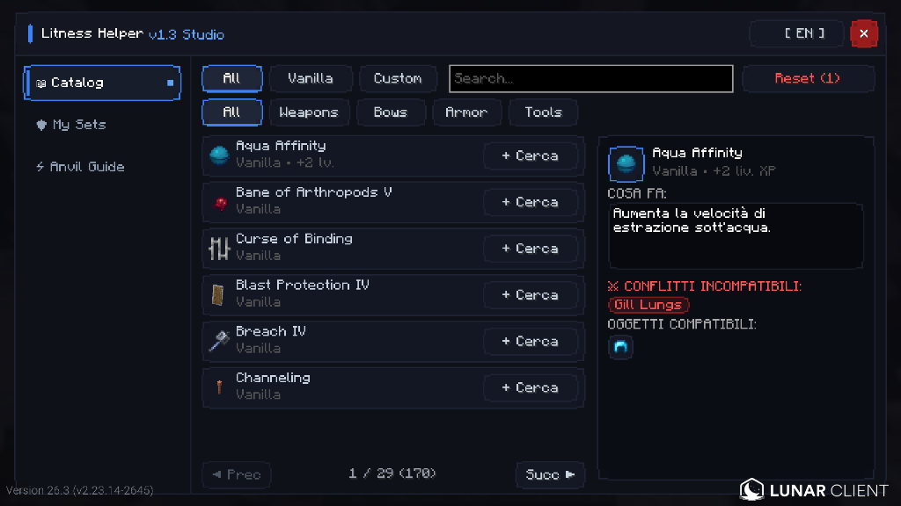
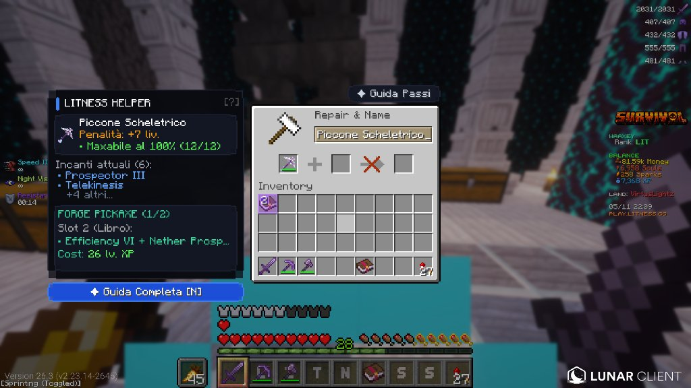
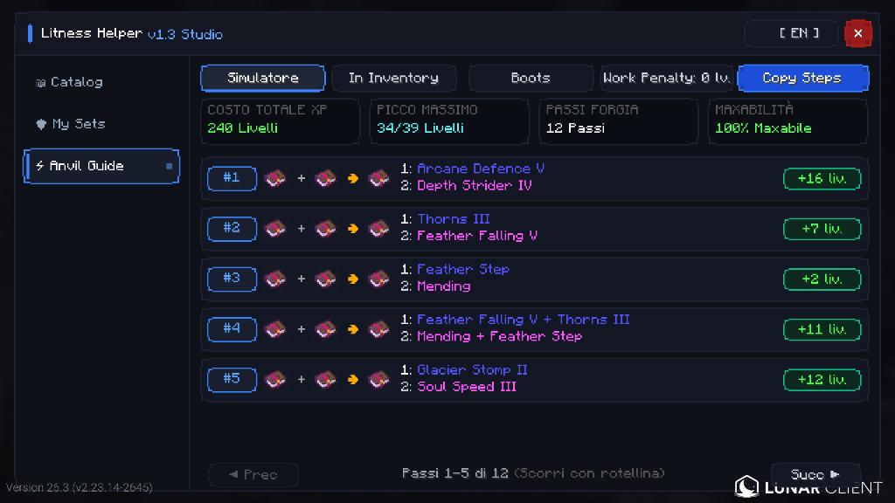
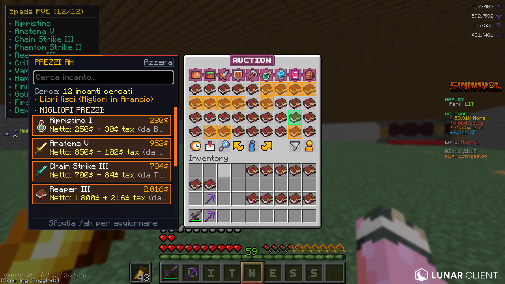
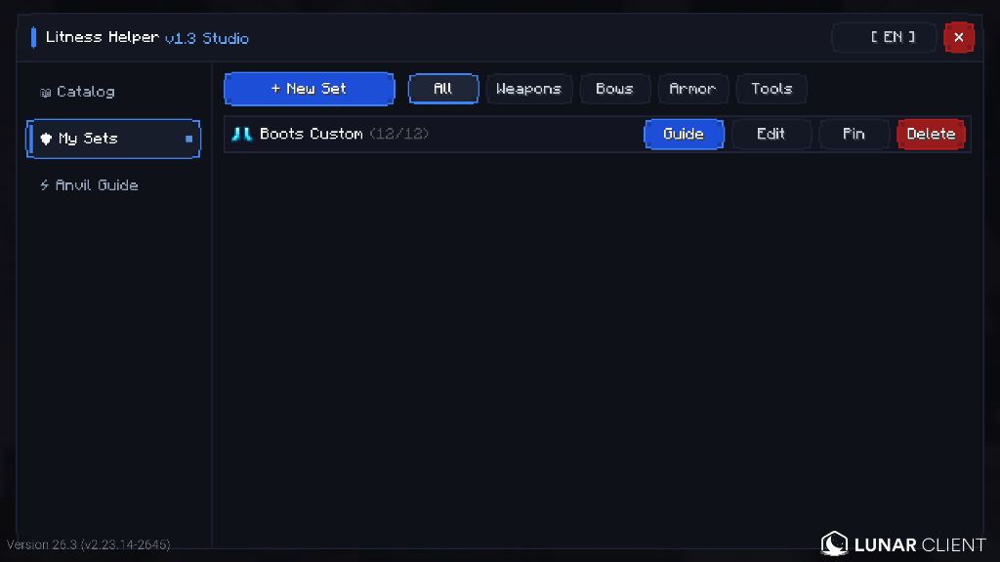
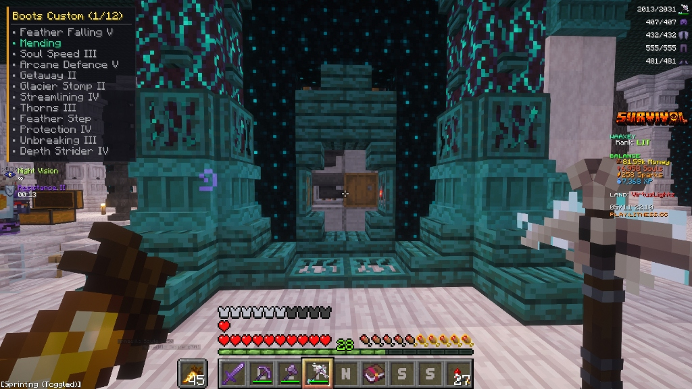

# ⚡ Litness Enchant v1.3.1 | By Waaxey

[-VERSIONE%201.3.1-22c55e?style=for-the-badge&logo=curseforge&logoColor=white)](https://github.com/Infezione/litness-enchant-helper/releases/download/v1.3.1/LitnessEnchantHelper-1.3.1.jar)
[](#ultimi-aggiornamenti)


> [!TIP]
> ### 💡 Come aprire il menu in gioco:
> Premi semplicemente il tasto **`N`** sulla tastiera in qualsiasi momento per aprire la nuova interfaccia software **Litness Enchant v1.3 Studio** (Catalogo Incantesimi, I Miei Set, Calcolatore & Guida Incudine).  
> *(Puoi personalizzare il tasto in `Opzioni -> Comandi -> Controlli` di Minecraft sotto la voce "Litness Optimizer").*

**Litness Enchant** è la mod Fabric client-side definitiva, creata appositamente per i giocatori del server Minecraft **Litness**.  
Il suo obiettivo è eliminare per sempre qualsiasi spreco di livelli di esperienza, aggirare con precisione matematica l'errore di Minecraft vanilla *"Troppo Costoso! (>39 livelli)"* e guidare il giocatore passo dopo passo nella creazione dell'equipaggiamento perfetto, supportando tutti i 170 incantesimi Vanilla, Vanilla+ e Custom esclusivi del server.

---

## 🌟 Perché è fondamentale su Litness?

Sul server Litness, maxare un'arma o un pezzo d'armatura con 10–12 incantesimi (tra Vanilla e Custom) è quasi impossibile se non si conosce l'esatta combinazione matematica dell'incudine (*Prior Work Penalty*). Se i libri vengono uniti in sequenza lineare o nell'ordine sbagliato, l'incudine supererà rapidamente il limite di 39 livelli, bloccando l'oggetto per sempre.

**Litness Enchant v1.3** implementa un avanzatissimo motore matematico ad **albero binario Pareto-ottimale (Dynamic Programming)** che calcola in tempo reale la sequenza ideale di combinazione tra libri, mantenendo i costi di ogni singola forgiatura a un picco tipico di soli **20–28 livelli XP**, consentendo a chiunque di maxare oggetti al **100% (12/12 incantesimi)** senza mai rischiare il blocco!

---

## 🚀 Panoramica delle Funzionalità

### 1. 🖥️ Nuova Interfaccia "Obsidian Studio" v1.3

- **Design Desktop Software**: stile dark-glass moderno e pulito (ispirato ad app professionali come Marloww Client e Obsidian), con angoli arrotondati, pulsanti interattivi e accenti al neon.
- **Header con Branding Ufficiale**: `Litness Enchant v1.3 | By Waaxey`.
- **Tasto Rapido Lingua Bilingue `[IT]` / `[EN]`**: situato in alto a destra nell'header con bandierine pixel art per cambiare al volo la lingua di tutti i testi, lore e nomi degli incantesimi.
- **Struttura a Schede**:
  - 📖 **Catalogo**: 170 incantesimi indicizzati con filtri veloci per categoria (Spade, Archi, Mazze, Picconi, Armature, ecc.).
  - 🛡️ **I Miei Set**: Creazione e gestione set salvati con anteprima 3D dell'item, lore completa e socket incantesimi.
  - ⚡ **Guida Incudine**: Calcolatore teorico (Simulatore) e tracker dei libri reali presenti nel tuo Inventario.

---

### 2. ⚡ Assistente Incudine Live con Analisi Maxabilità Reale

- **Analisi Istantanea Maxabilità**:
  - Rileva in automatico la penalità pregressa da lavorazione (*Prior Work Penalty*).
  - Algoritmo matematico avanzato: gli oggetti con lavoro pregresso $\le 2$ (penalità +0, +1 e +3) vengono riconosciuti come **100% Maxabili fino a 12/12 incantesimi**.
  - Badge verde luminoso `✔ Maxabile al 100% (12/12)` con tooltip dettagliato che spiega come unire i libri ad albero binario.
  - Se un oggetto ha penalità troppo elevata (+7, +15, +31), calcola a ritroso l'esatto numero massimo di incantesimi ancora applicabili prima del blocco (es. `Puoi ancora aggiungere fino a 8 incantesimi`).
- **Ologramma Pulsante (Ghost Slot)**: quando lo slot 1 dell'incudine è vuoto, una sagoma dorata pulsante ti ricorda quale pezzo inserire per iniziare.
- **Glow Celeste & Targhette Fisse `[SLOT 1]` e `[SLOT 2]` nell'Inventario**:
  - Analizza il tuo inventario in tempo reale e illumina con un alone celeste pulsante i libri esatti necessari per il passaggio corrente.
  - Targhette fisse sopra ogni slot per mostrarti a colpo d'occhio dove inserire ogni libro nell'incudine senza dover toccare il mouse.

---

### 3. 🌳 Simulatore Fusione Pareto-Ottimale ad Albero Binario

- **Albero Binario Perfetto**: algoritmi di programmazione dinamica che combinano i libri tra loro prima di applicarli all'oggetto, riducendo drasticamente il costo cumulativo di XP.
- **Zero Lag / Calcolo Istantaneo**: esecuzione asincrona in thread pool dedicato; la guida compare all'istante senza causare alcun calo di FPS nel gioco.
- **Pulsante `[📋 Copia Passi]`**: esporta negli appunti l'intera sequenza di forgiatura ordinata con numeri di slot, nomi dei libri e costi di livelli XP, pronta per essere incollata su Discord.
- **Supporto Modalità "In Inventario"**: legge direttamente i libri magici presenti nel tuo inventario e genera la sequenza di forgiatura in base a ciò che possiedi realmente!

---

### 4. 🛒 Marketplace `/ah` Smart Multi-Page Crawler

- **Pulsante `[⚡ Sfoglia Tutto]`**: scansiona in pochi secondi l'intero catalogo della Casa d'Aste (`/ah`) sfogliando automaticamente tutte le pagine e memorizzando ogni singolo libro in vendita.
- **Navigazione Automatica su Click Offerta**: cliccando su una qualsiasi offerta nella sidebar laterale, la mod sfoglia le pagine dell'asta in automatico fino a raggiungere l'oggetto e apre direttamente il menu di conferma acquisto del server!
- **Confronto Prezzi Netto + Tasse**:
  - Calcola istantaneamente il prezzo netto e le relative tasse di compravendita del server (es. `Netto: 12.500$ + 1.500$ tax`).
  - Classifica ordinata dei venditori più convenienti dal più economico al più costoso.
- **Rimozione Automatica delle Inserzioni Vendute**: rileva in tempo reale quando un libro viene acquistato o rimosso e lo cancella istantaneamente dalla barra laterale.
- **Highlight Colorato degli Slot**:
  - 🟠 **Arancione Oro**: evidenzia il libro con il **Miglior Prezzo** assoluto.
  - 🟢 **Verde Smeraldo**: evidenzia tutti gli altri libri lisci corrispondenti alla ricerca.

---

### 5. 🛠️ Creatore & Gestore "I Miei Set" (Set Studio)

- **Studio Card con Lore Completa**: visualizza l'anteprima 3D dell'oggetto finale, la lista dei socket incantesimi, la rarità e il conteggio dinamico `(X/12)`.
- **Pianificazione Libera fino a 12 Incantesimi**: crea set personalizzati per qualsiasi pezzo (Spade, Picconi, Archi, Balestre, Mazze, Elmi, Corazze, Gambali, Stivali).
- **Controllo Conflitti Intelligente**: previene l'aggiunta di incantesimi incompatibili tra loro (*Affilatezza* vs *Anatema*, *Efficienza VI* vs *Efficienza I-V*, ecc.).
- **Tasto `[Guida]` Rapido**: carica con un solo clic il set salvato direttamente nel simulatore di forgiatura per visualizzare l'albero di fusione ottimale.
- **Tasto `[Pin]` / `[Sblocca]`**: fissa il set a schermo nell'HUD di gioco.

---

### 6. 📌 Pin HUD Checklist Live in Partita

- Overlay sempre visibile in alto a sinistra mentre esplori il mondo o combatti nei dungeon.
- **3 Stati Visivi Intelligenti**:
  - 🟢 **Verde (`✔`)**: libro incantato presente nel tuo inventario.
  - 🔴 **Rosso (`•`)**: incantesimo già forgiato sull'oggetto che stai impugnando.
  - ⚪ **Grigio**: incantesimo ancora da ottenere o comprare all'asta.

---

### 7. 📚 Catalogo 170 Incantesimi Litness
- **Database Completo al 100%**: comprende tutti gli incantesimi Vanilla, Vanilla+ (Efficienza VI) e Custom di Litness.
- **Ricerca Bilingue**: cerca digitando il nome in italiano o in inglese.
- **Filtri per Oggetto**: visualizza solo gli incantesimi applicabili all'oggetto desiderato.
- **Pulsante `[+ Cerca]` / `[+ Cerca AH]`**: evidenzia l'incantesimo in tutte le casse, shulker box e nell'asta `/ah`.

---

<a id="ultimi-aggiornamenti" name="ultimi-aggiornamenti"></a>
<a id="-ultimi-aggiornamenti" name="-ultimi-aggiornamenti"></a>

## 🌟 Ultimi Aggiornamenti - Novità Versione 1.3.1

- ⚡ **Ricerca Automatica & Auto-Acquisto /ah**:
  - Scansione ultra-veloce e intelligente di tutte le pagine della Casa d'Aste (`/ah`) con sincronizzazione sui pacchetti di rete del server.
  - Memorizzazione precisa della posizione reale di ciascuna offerta (Pagina e Slot esatto).
  - Cliccando su **✦ Clicca per acquistare** su qualsiasi offerta nella sidebar, la mod sfoglia le pagine da sola e apre istantaneamente il menu *"Comprare questo oggetto?"* per acquistare al volo il miglior prezzo!
- 🎨 **Nuove Animazioni Fluidissime & Cyber UI**:
  - Animazioni d'interfaccia fluide: Matrix Slide & Scale Pop, indicatore Cyber Neon Laser streak, Shockwave ripples al tocco o click su bottoni/card, transizioni animate tra schede e design pulito senza elementi superflui.
- 📋 **Copia & Incolla Set**:
  - Nuovi pulsanti **[Copia Set]** e **[Incolla Set]** nella sezione *"I Miei Set"* per esportare e importare con un clic i set personalizzati da condividere con gli amici, completi di notifica fluida animata a centro schermo.
- 🛠️ **Risoluzione Bug & Ottimizzazioni**:
  - Risolto definitivamente il disallineamento off-by-one dei numeri di pagina e il blocco a fine asta.

---

## 🌟 Novità Versione 1.3.0

- 🚀 **Rilascio Ufficiale "Litness Enchant v1.3 | By Waaxey"**:
  - Nuova interfaccia grafica Studio con branding ufficiale e stabilità completa.
- 🌳 **Integrazione Motore Pareto-Ottimale ad Albero Binario (Dynamic Programming)**:
  - Sostituito il vecchio sistema di calcolo con il potente algoritmo DP ad albero binario: combina fino a 12 incanti con picchi di soli 20-28 livelli XP.
- ⚡ **Fix Matematico Maxabilità su Incudine**:
  - Eliminato il falso allarme "Troppo Costoso" per gli oggetti a lavoro 2 (penalità +3); ora tutti gli oggetti con penalità +0, +1 e +3 vengono correttamente riconosciuti come **100% Maxabili (12/12)**.
- 🛒 **Auto-Crawler Multi-Pagina `/ah` (`[⚡ Sfoglia Tutto]`)**:
  - Scansiona e memorizza tutti i libri di tutte le pagine dell'asta, con auto-navigazione e apertura automatica della schermata di acquisto al clic sull'offerta più conveniente.
- 🛡️ **Fix Loop Infinito & Null-Safety**:
  - Risolto il blocco su *"Calcolo in corso..."* quando nessun libro era selezionato.
  - Aggiunta protezione completa contro i crash su unpin/pin dei set.

---

## 🎮 Controlli & Tasti Rapidi

| Tasto / Controllo | Azione |
| :--- | :--- |
| **`N`** | Apri il menu principale (Catalogo / I Miei Set / Guida Incudine) |
| **`[⚡ Sfoglia]`** | Scansiona tutte le pagine della Casa d'Aste (`/ah`) |
| **`[📋 Guida Passi]`** | Apri la guida ottimale direttamente dalla schermata dell'incudine |
| **`[📋 Copia Passi]`** | Copia l'intera sequenza di fusione negli appunti |
| **`[Pen: +X]`** | Seleziona manualmente la penalità pregressa (+0, +1, +3, +7, +15, +31) |
| **`[ESC]`** | Chiudi la schermata e torna al gioco |

---

## 📦 Installazione

### Per Lunar Client (Consigliato)
1. Scarica il file **`LitnessEnchantHelper-1.3.1.jar`** dall'area [Releases](../../releases).
2. Premi sulla tastiera `Win + R`, incolla la seguente stringa e premi **Invio**:
   ```text
   %userprofile%\.lunarclient\profiles\26\mods\fabric-26.3\
   ```
3. Incolla il file `LitnessEnchantHelper-1.3.1.jar` all'interno della cartella (rimuovendo eventuali versioni precedenti).
4. Avvia Minecraft da Lunar Client con la versione **26.3 (Fabric)**.

### Per Fabric Launcher Standard
1. Assicurati di avere installato **Fabric Loader** per Minecraft 26.3 e la **Fabric API**.
2. Posiziona il file `LitnessEnchantHelper-1.3.1.jar` nella cartella `.minecraft/mods/`.
3. Avvia il gioco.

---

## 👤 Autore & Crediti

- **Sviluppato da**: **Waaxey**
- Realizzato appositamente per la community del server **Litness**.
- Licenza: [MIT License](LICENSE)
