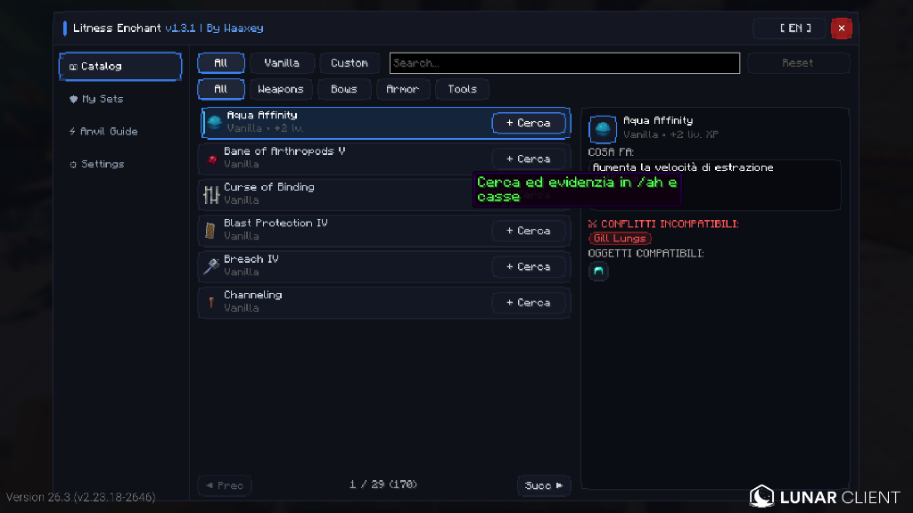
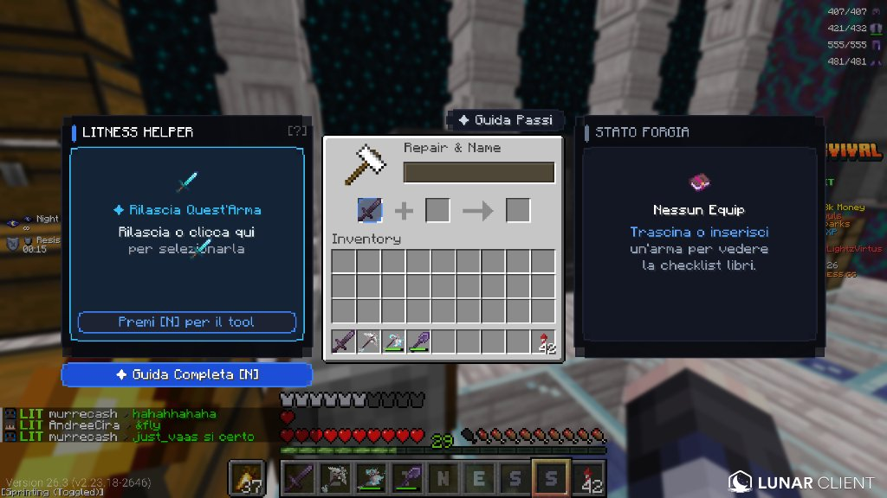
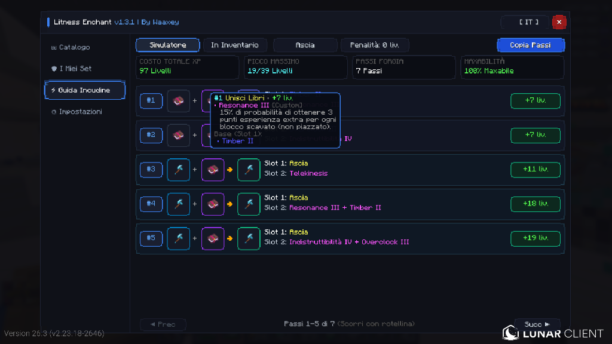
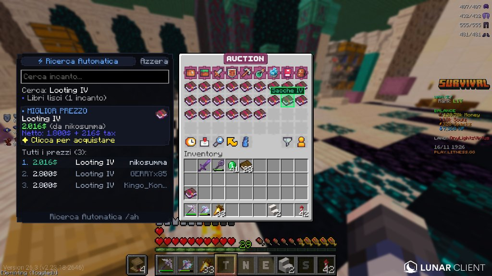
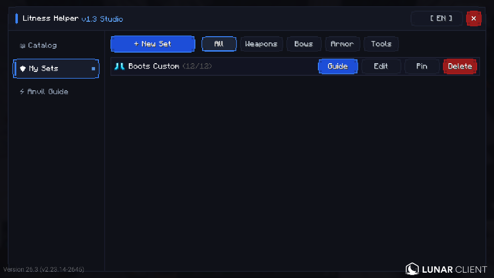
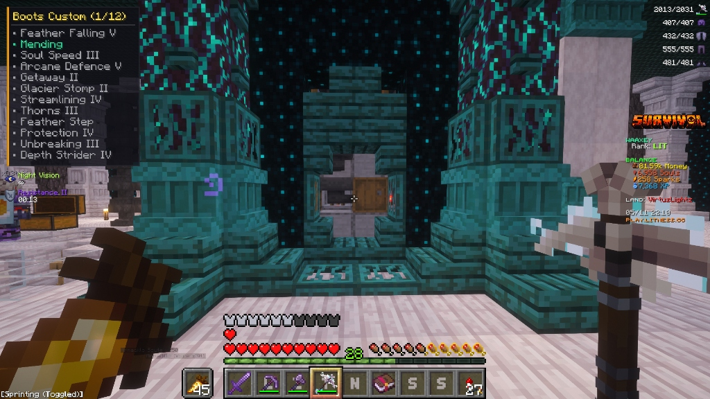
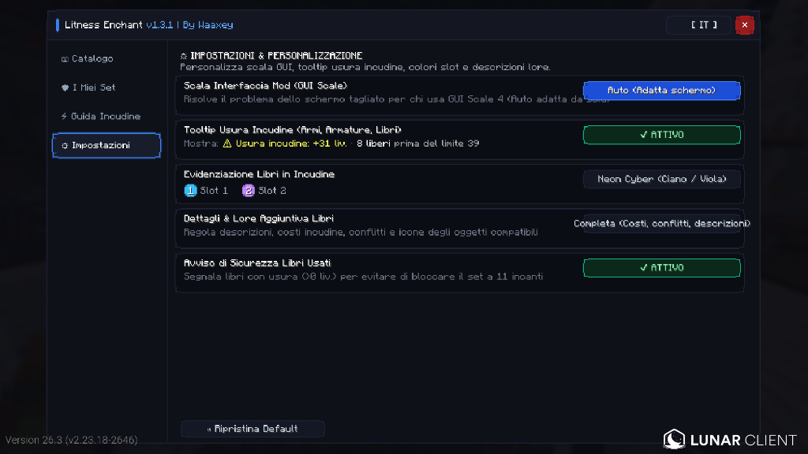
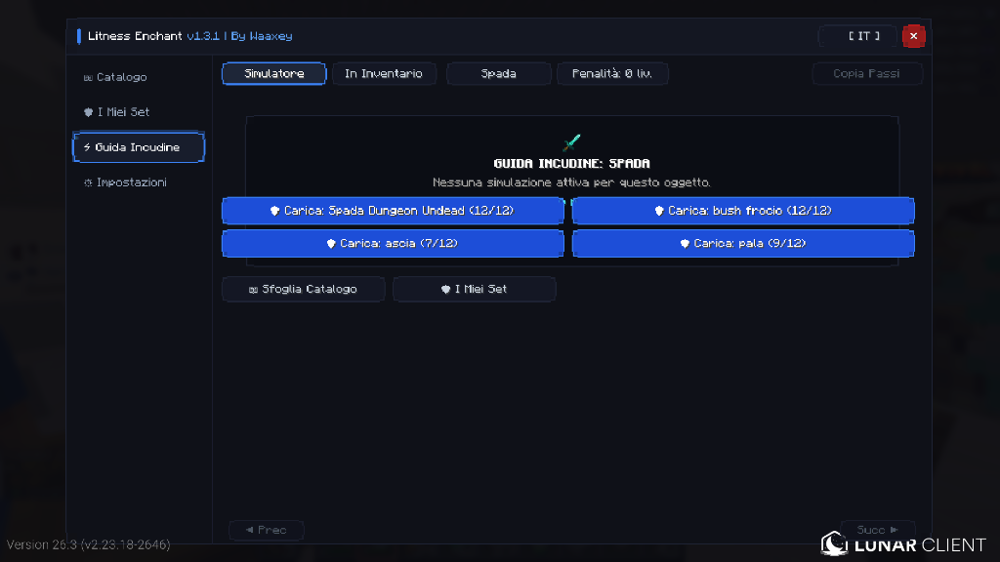

# ⚡ Litness Enchant v1.3.1 | By Waaxey

> [!WARNING]
> **DISCLAIMER**: Questo progetto non è affiliato, approvato o supportato da Litness Ltd. Lo usi a tuo rischio: potrebbe contenere bug o smettere di funzionare in qualsiasi momento. Litness Ltd non si assume alcuna responsabilità per ban, perdita di dati, account o oggetti, né per qualsiasi altro danno derivante dal suo utilizzo. Per assistenza contatta l'autore del progetto, non lo staff di Litness.

[-VERSIONE%201.3.1-22c55e?style=for-the-badge&logo=curseforge&logoColor=white)](https://github.com/Infezione/litness-enchant-helper/releases/download/v1.3.1/LitnessEnchantHelper-1.3.1.jar)
[](#ultimi-aggiornamenti)


> [!TIP]
> ### 💡 Come aprire il menu in gioco:
> Premi semplicemente il tasto **`N`** sulla tastiera in qualsiasi momento per aprire la nuova interfaccia software **Litness Enchant v1.3 Studio** (Catalogo Incantesimi, I Miei Set, Calcolatore & Guida Incudine).  
> *(Puoi personalizzare il tasto in `Opzioni -> Comandi -> Controlli` di Minecraft sotto la voce "Litness Optimizer").*

**Litness Enchant** è la mod Fabric client-side definitiva, creata appositamente per i giocatori del server Minecraft **Litness**.  
Il suo obiettivo è eliminare per sempre qualsiasi spreco di livelli di esperienza, aggirare con precisione matematica l'errore di Minecraft vanilla *"Troppo Costoso! (>39 livelli)"* e guidare il giocatore passo dopo passo nella creazione dell'equipaggiamento perfetto, supportando tutti i 170 incantesimi Vanilla, Vanilla+ e Custom esclusivi del server.

---

## 🌟 Perché è fondamentale su Litness?

Sul server Litness, maxare un'arma o un pezzo d'armatura con 10–12 incantesimi (tra Vanilla e Custom) è quasi impossibile se non si conosce l'esatta combinazione matematica dell'incudine (*Prior Work Penalty*). Se i libri vengono uniti in sequenza lineare o nell'ordine sbagliato, l'incudine supererà rapidamente il limite di 39 livelli, bloccando l'oggetto per sempre.

**Litness Enchant v1.3** implementa un avanzatissimo motore matematico ad **albero binario Pareto-ottimale (Dynamic Programming)** che calcola in tempo reale la sequenza ideale di combinazione tra libri, mantenendo i costi di ogni singola forgiatura a un picco tipico di soli **20–28 livelli XP**, consentendo a chiunque di maxare oggetti al **100% (12/12 incantesimi)** senza mai rischiare il blocco!

---

## 🚀 Panoramica delle Funzionalità

### 1. 🖥️ Nuova Interfaccia "Obsidian Studio" v1.3

- **Design Desktop Software**: stile dark-glass moderno e pulito (ispirato ad app professionali come Marloww Client e Obsidian), con angoli arrotondati, pulsanti interattivi e accenti al neon.
- **Header con Branding Ufficiale**: `Litness Enchant v1.3 | By Waaxey`.
- **Tasto Rapido Lingua Bilingue `[IT]` / `[EN]`**: situato in alto a destra nell'header con bandierine pixel art per cambiare al volo la lingua di tutti i testi, lore e nomi degli incantesimi.
- **Struttura a Schede**:
  - 📖 **Catalogo**: 170 incantesimi indicizzati con filtri veloci per categoria (Spade, Archi, Mazze, Picconi, Armature, ecc.).
  - 🛡️ **I Miei Set**: Creazione e gestione set salvati con anteprima 3D dell'item, lore completa e socket incantesimi.
  - ⚡ **Guida Incudine**: Calcolatore teorico (Simulatore) e tracker dei libri reali presenti nel tuo Inventario.

---

### 2. ⚡ Assistente Incudine Live con Analisi Maxabilità Reale

- **Selezione Intuitiva & Drag and Drop**: seleziona l'arma trascinandola e rilasciandola nella barra sinistra, inserendola nello Slot 1 dell'incudine, oppure semplicemente cliccandola nel tuo inventario.
- **Pannello Destro "Stato Forgia"**: checklist istantanea dei libri mancanti consigliati, con filtro rigido anti-conflitto.
- **Analisi Istantanea Maxabilità**:
  - Rileva in automatico la penalità pregressa da lavorazione (*Prior Work Penalty*).
  - Badge luminoso `✔ Maxabile al 100% (12/12)` con analisi dettagliata.
  - Se un oggetto ha penalità troppo elevata (+7, +15, +31), calcola a ritroso l'esatto numero massimo di incantesimi ancora applicabili prima del blocco (es. `Puoi ancora aggiungere fino a 8 incantesimi`).
- **Glow Celeste & Targhette Fisse `[SLOT 1]` e `[SLOT 2]` nell'Inventario**:
  - Analizza il tuo inventario in tempo reale e illumina con un alone pulsante i libri esatti necessari per il passaggio corrente.

---

### 3. 🌳 Simulatore Fusione Pareto-Ottimale ad Albero Binario

- **Albero Binario Perfetto**: algoritmi di programmazione dinamica che combinano i libri tra loro prima di applicarli all'oggetto, riducendo drasticamente il costo cumulativo di XP.
- **Zero Lag / Calcolo Istantaneo**: esecuzione asincrona in thread pool dedicato; la guida compare all'istante senza causare alcun calo di FPS nel gioco.
- **Pulsante `[📋 Copia Passi]`**: esporta negli appunti l'intera sequenza di forgiatura ordinata con numeri di slot, nomi dei libri e costi di livelli XP, pronta per essere incollata su Discord.
- **Supporto Modalità "In Inventario"**: legge direttamente i libri magici presenti nel tuo inventario e genera la sequenza di forgiatura in base a ciò che possiedi realmente!

---

### 4. 🛒 Assistente Prezzi & Ricerca Libri `/ah`

- **Barra di Ricerca Rapida**: digita il nome di qualsiasi incantesimo per filtrare all'istante le offerte migliori con autocompletamento intelligente.
- **Tracciamento Prezzi Passivo & Sicuro (100% Legit, Zero Botting)**:
  - Navigando normalmente tra le pagine della Casa d'Aste (`/ah`), la mod memorizza passivamente i libri in vendita e calcola il miglior prezzo disponibile.
  - Nessun macro-click o automazione bannabile: totale conformità al regolamento di gioco.
- **Confronto Prezzi Netto + Tasse**:
  - Calcola istantaneamente il prezzo netto e le relative tasse di compravendita del server (es. `Netto: 12.500$ + 1.500$ tax`).
  - Classifica ordinata dei venditori più convenienti dal più economico al più costoso.
- **Promemoria Posizione Offerte**: cliccando su un'offerta salvata nella barra laterale, ricevi l'indicazione esatta di **Pagina** e **Slot** in cui trovare il libro al prezzo migliore.
- **Highlight Colorato degli Slot**:
  - 🟠 **Arancione Oro**: evidenzia il libro con il **Miglior Prezzo** assoluto.
  - 🟢 **Verde Smeraldo**: evidenzia tutti gli altri libri lisci corrispondenti alla ricerca.

---

### 5. 🛠️ Creatore & Gestore "I Miei Set" (Set Studio)

- **Studio Card con Lore Completa**: visualizza l'anteprima 3D dell'oggetto finale, la lista dei socket incantesimi, la rarità e il conteggio dinamico `(X/12)`.
- **Pianificazione Libera fino a 12 Incantesimi**: crea set personalizzati per qualsiasi pezzo (Spade, Picconi, Archi, Balestre, Mazze, Elmi, Corazze, Gambali, Stivali).
- **Controllo Conflitti Intelligente**: previene l'aggiunta di incantesimi incompatibili tra loro (*Affilatezza* vs *Anatema*, *Efficienza VI* vs *Efficienza I-V*, ecc.).
- **Tasto `[Guida]` Rapido**: carica con un solo clic il set salvato direttamente nel simulatore di forgiatura per visualizzare l'albero di fusione ottimale.
- **Tasto `[Pin]` / `[Sblocca]`**: fissa il set a schermo nell'HUD di gioco.
- **📤 Condivisione Rapida con gli Amici (`[Copia Set]` & `[Incolla Set]`)**:
  - **Tasto `[Copia Set]`**: posizionato accanto al tasto `Edit` di ciascun set salvato. Con un solo clic copia negli appunti l'intera configurazione (tipo di pezzo, nome e tutti gli incantesimi) in un formato testo pulito e leggibile, pronto per essere inviato su Discord, Telegram o chat di gioco.
  - **Tasto `[Incolla Set]`**: situato in alto a destra nella sezione dei set. Legge automaticamente gli appunti e crea all'istante il set completo senza dover selezionare manualmente tutti i libri!
  - **Notifica Fluida Animata**: una notifica a centro schermo con animazione Cyber Matrix conferma istantaneamente il successo dell'importazione o dell'esportazione.
  - **Doppio Formato Supportato**: funziona sia con il formato leggibile `Set: Nome | item | incanto1, incanto2...` sia con le stringhe compatte `LITSET:...`.

---

### 6. 📌 Pin HUD Checklist Live in Partita

- Overlay sempre visibile in alto a sinistra mentre esplori il mondo o combatti nei dungeon.
- **3 Stati Visivi Intelligenti**:
  - 🟢 **Verde (`✔`)**: libro incantato presente nel tuo inventario.
  - 🔴 **Rosso (`•`)**: incantesimo già forgiato sull'oggetto che stai impugnando.
  - ⚪ **Grigio**: incantesimo ancora da ottenere o comprare all'asta.

---

### 7. 📚 Catalogo 170 Incantesimi Litness
- **Database Completo al 100%**: comprende tutti gli incantesimi Vanilla, Vanilla+ (Efficienza VI) e Custom di Litness.
- **Ricerca Bilingue**: cerca digitando il nome in italiano o in inglese.
- **Filtri per Oggetto**: visualizza solo gli incantesimi applicabili all'oggetto desiderato.
- **Pulsante `[+ Cerca]` / `[+ Cerca AH]`**: evidenzia l'incantesimo in tutte le casse, shulker box e nell'asta `/ah`.

---

<a id="ultimi-aggiornamenti" name="ultimi-aggiornamenti"></a>
<a id="-ultimi-aggiornamenti" name="-ultimi-aggiornamenti"></a>

## 🌟 Ultimi Aggiornamenti - Novità Versione 1.3.1



- ⚙️ **Nuova Scheda "Impostazioni & Personalizzazione" (`[N] -> Impostazioni`)**:
  - **Scala Interfaccia Mod (GUI Scale personalizzabile)**:
    - Risolto definitivamente il problema dello schermo tagliato a metà per chi gioca con **GUI Scale 4** o monitor compatti.
    - Modalità selezionabili: `Auto (Adatta schermo dinamicamente)`, `GUI Scale 1`, `GUI Scale 2`, `GUI Scale 3`, `GUI Scale 4`.
  - **Personalizzazione Evidenziazione Libri in Incudine**:
    - Menu a tendina con palette colori personalizzabili per Slot 1 e Slot 2 (*Neon Cyber*, *Ambra & Smeraldo*, *Fuoco & Ghiaccio*, *Matrix Hacker*, *Oro & Ametista*).
  - **Dettagli Lore & Descrizioni Libri**:
    - Regolabile su 4 livelli: *Completa (Costi XP, descrizioni e conflitti)*, *Compatta (Solo costi base e livello)*, *Minimale (Solo nome e livello)*, *Disattivata*.
  - **Avviso di Sicurezza Libri Usati**:
    - Rileva e segnala automaticamente con allerta visiva i libri già lavorati con penalità incudine (>0 liv.), proteggendo il set dal rischio di blocco a 11 incantesimi.

- 🔨 **Assistente Incudine Potenziato (Drag & Drop, Clic Diretto & Salvataggio)**:
  - **Nuovo Tasto `[✕ Azzera]` & Reset Istantaneo**: comodo tasto per azzerare e disattivare l'arma selezionata nella barra laterale, eliminando blocchi o selezioni involontarie.
  - **Protezione Slot Sacrificio (Slot 1)**: impedisce che l'inserimento di un libro o di un secondo item nello slot di sacrificio modifichi o sovrascriva l'arma base in lavorazione.
  - **Selezione Intuitiva**: seleziona l'arma trascinandola nella barra sinistra, inserendola nello slot 0 dell'incudine o cliccandola nel tuo inventario.
  - **Salvataggio & Persistenza**: l'arma selezionata rimane memorizzata se desiderato, oppure azzerabile con un clic.
  - **Distinzione Esatta dei Tipi di Oggetti**: risolto lo scambio accidentale tra armi diverse (es. Spada in Diamante vs Netherite con nome personalizzato).

- 📜 **Nuovo Pannello Destro "Stato Forgia" (Checklist Intelligente Senza Conflitti)**:
  - Analisi in tempo reale di tutti i libri necessari con barra di avanzamento e conteggio `[X/12 Libri Pronti]`.
  - **Filtro Rigido Anti-Conflitto**: esclude categoricamente qualsiasi incantesimo incompatibile o in conflitto con quelli già presenti sull'arma o tra i mancanti.

- 📖 **Lore dei Libri Pulita & Usura Incudine Professionale**:
  - Nella sezione conflitti dei libri viene mostrato solo il **nome** del conflitto, senza spiegazioni o descrizioni superflue.
  - Rimossa la voce ingannevole *"39 liberi"* dai libri senza usura.
  - Sugli oggetti con 12 incanti la dicitura viene aggiornata con lo stato professionale: `✦ Usura incudine: +X livelli · ✔ MASSIMO RAGGIUNTO (12/12)`.

- ⚡ **Nuova Scheda "Guida Incudine" Pulita & Diretta**:
  
  - Mostra direttamente e unicamente la lista dei tuoi **Set Salvati** con il comodo tasto `[⚡ Mostra Guida]`.
  - Al clic, visualizza i passi di forgiatura ordinati con schede da 44px, icone 3D di Slot 1, Slot 2 e Risultato finale, pillola XP color verde smeraldo e tasto `[⬅ Torna ai Set]`.
  - Eliminati i vecchi tooltip ingombranti che coprivano le righe durante il passaggio del mouse.

- 🛒 **Assistente Ricerca Libri `/ah`**:
  - Ricerca rapida con autocompletamento e tracciamento passivo dei prezzi migliori tra tutte le pagine consultate senza automazioni rischiose.

- 📋 **Copia & Incolla Rapido dei Set**:
  - Condivisione istantanea dei set personalizzati tramite appunti con notifica animata Cyber Matrix a centro schermo.

---

## 🌟 Novità Versione 1.3.0

- 🚀 **Rilascio Ufficiale "Litness Enchant v1.3 | By Waaxey"**:
  - Nuova interfaccia grafica Studio con branding ufficiale e stabilità completa.
- 🌳 **Integrazione Motore Pareto-Ottimale ad Albero Binario (Dynamic Programming)**:
  - Sostituito il vecchio sistema di calcolo con il potente algoritmo DP ad albero binario: combina fino a 12 incanti con picchi di soli 20-28 livelli XP.
- ⚡ **Fix Matematico Maxabilità su Incudine**:
  - Eliminato il falso allarme "Troppo Costoso" per gli oggetti a lavoro 2 (penalità +3); ora tutti gli oggetti con penalità +0, +1 e +3 vengono correttamente riconosciuti come **100% Maxabili (12/12)**.
- 🛒 **Assistente Prezzi `/ah` (Legit & Sicuro)**:
  - Tracciamento passivo dei prezzi dei libri e autocompletamento rapido in conformità al regolamento del server.
- 🛡️ **Fix Loop Infinito & Null-Safety**:
  - Risolto il blocco su *"Calcolo in corso..."* quando nessun libro era selezionato.
  - Aggiunta protezione completa contro i crash su unpin/pin dei set.

---

## 🎮 Controlli & Tasti Rapidi

| Tasto / Controllo | Azione |
| :--- | :--- |
| **`N`** | Apri il menu principale (Catalogo / I Miei Set / Guida Incudine) |
| **`Cerca incanto...`** | Barra di ricerca con autocompletamento nella Casa d'Aste (`/ah`) |
| **`[Azzera]`** | Resetta i filtri attivi di ricerca in `/ah` |
| **`[Copia Set]`** | Esporta e copia negli appunti la configurazione del set da passare agli amici |
| **`[Incolla Set]`** | Importa istantaneamente negli appunti un set condiviso |
| **`[📋 Guida Passi]`** | Apri la guida ottimale direttamente dalla schermata dell'incudine |
| **`[📋 Copia Passi]`** | Copia l'intera sequenza di fusione negli appunti |
| **`[Pen: +X]`** | Seleziona manualmente la penalità pregressa (+0, +1, +3, +7, +15, +31) |
| **`[ESC]`** | Chiudi la schermata e torna al gioco |

---

## 📦 Installazione

### Per Lunar Client (Consigliato)
1. Scarica il file **`LitnessEnchantHelper-1.3.1.jar`** dall'area [Releases](../../releases).
2. Premi sulla tastiera `Win + R`, incolla la seguente stringa e premi **Invio**:
   ```text
   %userprofile%\.lunarclient\profiles\26\mods\fabric-26.3\
   ```
3. Incolla il file `LitnessEnchantHelper-1.3.1.jar` all'interno della cartella (rimuovendo eventuali versioni precedenti).
4. Avvia Minecraft da Lunar Client con la versione **26.3 (Fabric)**.

### Per Fabric Launcher Standard
1. Assicurati di avere installato **Fabric Loader** per Minecraft 26.3 e la **Fabric API**.
2. Posiziona il file `LitnessEnchantHelper-1.3.1.jar` nella cartella `.minecraft/mods/`.
3. Avvia il gioco.

---

## 👤 Autore & Crediti

- **Sviluppato da**: **Waaxey**
- Realizzato appositamente per la community del server **Litness**.
- Licenza: [MIT License](LICENSE)
